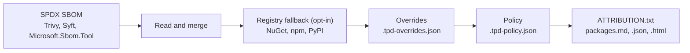

# ThirdPartyDetective

[](https://github.com/hectortosa/ThirdPartyDetective/actions/workflows/ci.yml)


**Website:** [hectortosa.github.io/ThirdPartyDetective](https://hectortosa.github.io/ThirdPartyDetective/)

ThirdPartyDetective (TPD) turns the SBOM your security tooling already produces into the third-party notices you ship with your software, and checks every dependency's license against how you deploy it.

It reads SPDX 2.2/2.3 JSON from Trivy, Syft or Microsoft.Sbom.Tool, resolves what the SBOM leaves open from the NuGet, npm and PyPI registries, and writes an `ATTRIBUTION.txt` plus Markdown, JSON and HTML reports. It is a single executable for Linux, macOS and Windows, with no native scanning and no dependency on your package managers or a .NET installation.

## Contents

- [Why TPD](#why-tpd)
- [How it works](#how-it-works)
- [Quickstart](#quickstart)
- [What the notices look like](#what-the-notices-look-like)
- [Installing](#installing)
- [Usage](#usage)
- [Configuration](#configuration)
- [Ecosystems](#ecosystems)
- [In CI](#in-ci)
- [Reproducible output](#reproducible-output)
- [Output files](#output-files)
- [Development](#development)

## Why TPD

`ATTRIBUTION.txt` is a legal document: it travels with your product to customers. TPD is built around that.

- **Every component, as declared.** Each package appears with its SPDX license expression exactly as declared (`PostgreSQL`, `MIT OR Apache-2.0`, `GPL-2.0-only WITH Classpath-exception-2.0`), its copyright lines and, when available, its own license and NOTICE files. Appendix A carries the text of every license, exception and custom license used.
- **No guessing.** A license is named only when the evidence names it. Vague declarations ("BSD", "Dual License") and texts with extra terms are reported as "not determined", and `--fail-on-unresolved` stops them from shipping until someone records a decision.
- **Reproducible.** The SPDX license list is bundled in the tool, registry answers can be pinned in a committed cache, and the same SBOM gives byte-identical output on any machine.
- **Safe with third-party metadata.** Package names, copyright lines, URLs and license files are untrusted input: they are sanitized before they reach a report or a CI log, and network access goes only to the registries and public license hosts, with size and time caps.
- **Fast and light.** About 0.6 seconds for a 10,000-package SBOM on an Apple M2 Pro, with all four reports and no registry lookups. Its only runtime dependencies are System.CommandLine and Microsoft.Extensions.

## How it works



1. **Read and merge.** One or more SBOMs are read and merged per package; the first source that declares a license wins.
2. **Registry fallback** (`--registry-fallback`). Packages the SBOM leaves without a license or a copyright notice are looked up in their registry, including the license files inside the exact version's package. It fills gaps only and never replaces what the SBOM declares.
3. **Overrides.** Decisions a person made for a specific package version replace everything else.
4. **Policy.** Each license is placed in a policy class and checked against the deployment mode (SaaS or distribution).
5. **Reports.** `ATTRIBUTION.txt` lists every component, whatever its policy class; the other reports show the policy result.

## Quickstart

```bash
# Install a release (see Installing for other platforms and pinned installs)
brew install hectortosa/tap/thirdpartydetective

# Generate an SBOM (Trivy shown; Syft and Microsoft.Sbom.Tool work too)
trivy fs --format spdx-json --output sbom.spdx.json ./publish

# Write the third-party notices, with license texts
thirdpartydetective --sbom sbom.spdx.json --mode distribution --registry-fallback \
  --format fulltext --include-license-text
```

## What the notices look like

An abridged excerpt of `ATTRIBUTION.txt` for the Node.js project in the test fixtures:

```text
THIRD PARTY SOFTWARE NOTICES AND INFORMATION
============================================================

This software incorporates components from the projects listed below.

5. @mui/x-license 7.29.1
   Copyright: Copyright (c) 2020 Material-UI SAS
   License: LicenseRef-be3dcefa7e8e646a (see Appendix A)
   Project URL: https://github.com/mui/mui-x

14. indexof 0.0.1
   License: not determined (NOASSERTION)

18. jszip 3.10.1
   Copyright: Copyright (c) 2009-2016 Stuart Knightley, David Duponchel, Franz Buchinger, António Afonso
   License: MIT OR GPL-3.0-or-later (see Appendix A)
   Project URL: https://github.com/Stuk/jszip

   License Text (from the package):
   ----------------------------------------
   ...

APPENDIX A: LICENSE TEXTS
============================================================

--- LicenseRef-be3dcefa7e8e646a (SEE-LICENSE-IN-LICENSE) ---

   Commercial License

   Copyright (c) 2020 Material-UI SAS

   MUI X Pro (https://mui.com/pricing/) is commercial software. ...
```

The commercial package's real terms come from its own `LICENSE` file, the dual-licensed one keeps its `OR`, and the package with no license anywhere is reported, not guessed. The full outputs for .NET, npm and Python projects are in [`ThirdPartyDetective.Cli.Tests/Golden/`](ThirdPartyDetective.Cli.Tests/Golden/).

## Installing

Each [GitHub release](https://github.com/hectortosa/ThirdPartyDetective/releases) carries a standalone executable per platform. The .NET runtime is bundled, so nothing else needs to be installed.

| Platform | Archive |
|---|---|
| Linux x64 | `thirdpartydetective_<version>_linux-x64.tar.gz` |
| Linux arm64 | `thirdpartydetective_<version>_linux-arm64.tar.gz` |
| macOS, Apple silicon | `thirdpartydetective_<version>_osx-arm64.tar.gz` |
| macOS, Intel | `thirdpartydetective_<version>_osx-x64.tar.gz` |
| Windows x64 | `thirdpartydetective_<version>_win-x64.zip` |

Each archive holds the executable at its root, with `LICENSE`, this README, `THIRD-PARTY-NOTICES.txt` and the bundled .NET runtime's license and notices. The release also carries `SHA256SUMS`, an SPDX SBOM per executable and build provenance attestations. The Linux executables need a glibc-based distribution (Alpine and other musl-based images are not supported) and, for `--registry-fallback`, OpenSSL.

TPD is distributed only through its GitHub releases and the Homebrew tap below. It is not published on nuget.org or any other package registry, so a package named ThirdPartyDetective found on one did not come from this project.

**Homebrew** (macOS and Linux):

```bash
brew install hectortosa/tap/thirdpartydetective
```

**Download and verify:**

```bash
V=1.0.0 RID=linux-x64   # or linux-arm64, osx-arm64, osx-x64
base=https://github.com/hectortosa/ThirdPartyDetective/releases/download/v$V
curl -fsSLO "$base/thirdpartydetective_${V}_${RID}.tar.gz"
curl -fsSLO "$base/SHA256SUMS"
sha256sum --check --ignore-missing SHA256SUMS   # older macOS: shasum -a 256 --check --ignore-missing SHA256SUMS
tar -xzf "thirdpartydetective_${V}_${RID}.tar.gz" thirdpartydetective
./thirdpartydetective --version
```

Then move `thirdpartydetective` to a directory on your `PATH`. On Windows, in PowerShell:

```powershell
$V = "1.0.0"
$base = "https://github.com/hectortosa/ThirdPartyDetective/releases/download/v$V"
Invoke-WebRequest "$base/thirdpartydetective_${V}_win-x64.zip" -OutFile thirdpartydetective.zip
(Get-FileHash thirdpartydetective.zip -Algorithm SHA256).Hash.ToLower()   # compare with the line in SHA256SUMS
Expand-Archive thirdpartydetective.zip -DestinationPath thirdpartydetective
.\thirdpartydetective\thirdpartydetective.exe --version
```

**Pinned, for CI, with [`install.sh`](install.sh).** `SHA256SUMS` downloaded next to an archive only proves the download is complete. In CI, keep the archive's hash in your repository (or a CI variable) and let `install.sh` check it, so a changed release asset fails the job:

```bash
curl -fsSLO https://raw.githubusercontent.com/hectortosa/ThirdPartyDetective/v1.0.0/install.sh
TPD_VERSION=1.0.0 TPD_SHA256=<sha256 of the archive for this platform> bash install.sh
```

It detects the platform, downloads the archive from the release, checks the hash before extracting anything, and installs the executable into `TPD_INSTALL_DIR` (default `~/.local/bin`). `TPD_ARCHIVE` installs from a local copy of the archive instead, for offline mirrors. Fetch the script from the release's tag, as above, not from `main`.

**Verifying provenance.** Every release file is attested by the workflow that built it. With the [GitHub CLI](https://cli.github.com/):

```bash
gh attestation verify thirdpartydetective_1.0.0_linux-x64.tar.gz --repo hectortosa/ThirdPartyDetective \
  --signer-workflow hectortosa/ThirdPartyDetective/.github/workflows/release.yml --source-ref refs/tags/v1.0.0
```

This confirms the file was built by this repository's Release workflow from the `v1.0.0` tag, on a GitHub-hosted runner.

**From source.** [`install-from-source.sh`](install-from-source.sh) packs your working copy and installs it as a .NET global tool (needs the .NET 10 SDK).

## Usage

```bash
thirdpartydetective --sbom <sbom.spdx.json> [options]
```

| Option | Description |
|---|---|
| `--sbom <path>` | **Required.** An SPDX 2.2/2.3 JSON SBOM. Repeat to merge several; per package, the first source that declares a license wins. |
| `--mode <saas\|distribution\|all>` | Deployment mode for the policy check. `byoc` and `on-premise` are aliases for `distribution`. Default: `all`, which applies no mode policy. |
| `--format <markdown\|json\|html\|fulltext\|console\|all>` | Which reports to write; `fulltext` is `ATTRIBUTION.txt`. Default: `all`. |
| `--output <dir>` | Output directory. Default: `./licenses`. |
| `--include-license-text` | Add Appendix A to `ATTRIBUTION.txt`, with the text of every license, exception and `LicenseRef-*` the packages use. |
| `--exclude-namespaces <list>` | Semicolon-separated package-name patterns to leave out entirely, such as your own projects. A trailing `*` matches a prefix. |
| `--registry-fallback` | Look up packages the SBOM leaves without a license or a copyright notice in NuGet, npm or PyPI. See [Ecosystems](#ecosystems). Licenses identified from a license text are flagged in the reports. |
| `--registry-fallback-cache <path>` | Cache for registry answers. Default: `./.tpd-license-cache.json`. If you commit it, review its changes like code: an entry decides a package's license. |
| `--offline` | Make no network requests; `--registry-fallback` only reads its cache. Also enabled by `TPD_OFFLINE=1`. |
| `--fail-on-unresolved` | Exit `2` when a license could not be determined or a text is missing from Appendix A. Applies even with `--no-fail`. |
| `--no-fail` | Exit `0` even with policy violations. |
| `--deterministic` | Leave the timestamp out of the reports, so identical inputs give byte-identical outputs. `SOURCE_DATE_EPOCH`, if set, is used as the timestamp instead. |
| `--policy <path>` | Policy config. Auto-discovered as `.tpd-policy.json` in the current directory. |
| `--overrides <path>` | Overrides config. Auto-discovered as `.tpd-overrides.json`. |
| `--notice-template <path>` | Notice template with legal wording for `ATTRIBUTION.txt`. Auto-discovered as `.tpd-notices.json`. |
| `--exclude-license-types <list>` | Treat these license types as violations, on top of the mode's policy. |
| `--include-license-types <list>` | Allow only these license types; replaces the mode's policy. |
| `--verbose` | Debug logging. |
| `--dev-info` | Include the source ecosystem and project paths in the reports. |

### Exit codes

| Code | Meaning |
|---|---|
| `0` | Success: no policy violations, or `--no-fail`. |
| `1` | Policy violations for the chosen `--mode`. Suppressed by `--no-fail`. |
| `2` | Operational error: bad command line, missing or malformed SBOM or config, unsupported SPDX version, malformed `SOURCE_DATE_EPOCH`, or (with `--fail-on-unresolved`) an undetermined license or a missing license text. Never suppressed by `--no-fail`. |

## Configuration

All three files are JSON and may contain comments and trailing commas. TPD finds them in the current directory, or takes a path from the matching option.

### Policy

`.tpd-policy.json` decides what counts as a violation in each deployment mode. Each mode lists either `violations` (everything else is allowed) or `allowed` (everything else is a violation):

```json
{
  "modes": {
    "saas": {
      "violations": ["AGPL-3.0", "GPL-2.0", "GPL-3.0", "Proprietary", "Unknown", "Multiple"]
    },
    "distribution": {
      "allowed": ["MIT", "Apache-2.0", "BSD-2-Clause", "BSD-3-Clause", "ISC", "MPL-2.0"]
    }
  }
}
```

Entries are SPDX IDs (`MIT`, `Apache-2.0`, `AGPL-3.0`) or the policy classes that have no SPDX ID: `Proprietary`, `Unknown` (a license that is not determined, or not one of TPD's policy classes, such as `CC-BY-4.0`) and `Multiple` (a compound expression that needs a decision). Without a policy file, `AGPL-3.0`, `Proprietary`, `Unknown` and `Multiple` are violations in distribution mode, and SaaS mode adds `GPL-2.0` and `GPL-3.0`.

The policy class is only used for this check. Reports always show the license expression as declared.

### Overrides

`.tpd-overrides.json` records decisions a person made, keyed on exact package name and version:

```json
{
  "overrides": [
    {
      "name": "dompurify",
      "version": "3.4.0",
      "license": "Apache-2.0",
      "authors": "Cure53 <info@cure53.de>",
      "copyright": "Copyright 2015 Mario Heiderich",
      "reviewer": "alice@example.com",
      "reviewedAt": "2026-04-30",
      "notes": "Dual licensed MPL-2.0 OR Apache-2.0: we use the Apache path."
    }
  ]
}
```

Use it when:

- a compound expression such as `MPL-2.0 OR Apache-2.0` needs a decision about which license you use;
- neither the SBOM nor the registry names the license: no license field and no license file, a free-text declaration such as "Dual License", or several license files with no expression saying how they combine;
- procurement needs authoritative authors or copyright text the SBOM lacks.

An override always wins over SBOM and registry values. With `--registry-fallback`, a package whose override sets `license` and has a copyright notice (the override's `copyright`, or the SBOM's) is not looked up at all, so its package archive is never downloaded; set `licenseTextFile` if its own license text should still be printed. Versions take no wildcards, so a version bump retires the entry: the new version gets reviewed and recorded again, and a stale entry simply stops matching. The `reviewer`, `reviewedAt` and `notes` fields make the file your compliance trail, and in `packages.json` an overridden package has `licenseSource: "Override"` and a warning naming the reviewer.

A package under a custom license can ship its real text: set `"license": "LicenseRef-<Name>"` and `"licenseTextFile": "licenses/<file>.txt"`, relative to the overrides file and inside its directory. The text becomes that LicenseRef's section in Appendix A, which also satisfies `--fail-on-unresolved`. With a regular SPDX license, `licenseTextFile` is printed under the package as its own license text, for example to keep its actual copyright line.

### Notice template

For GPL, LGPL and AGPL components, `ATTRIBUTION.txt` prints a note under the package. By default it states facts only:

```text
   Note: LGPL-2.1-only is a copyleft license. Its conditions for providing source code are in Appendix A.
```

How you make the source code of those components available (alongside the product, from the same place, or through a written offer) is a commitment by whoever ships the notices, so TPD doesn't write it. Your legal team supplies that wording in `.tpd-notices.json`:

```json
{
  // Example structure only: the wording must come from your legal team.
  "header": "<document-wide statement, e.g. how to obtain source code>",
  "copyleftNotes": {
    "LGPL": "<note for {name} {version} under {license}; project: {projectUrl}>",
    "GPL": "<...>",
    "AGPL": "<...>"
  },
  "footer": "<printed after the package list, before Appendix A>"
}
```

`header` follows the title, `footer` precedes Appendix A, and each `copyleftNotes` entry replaces the default note for that license family (an empty string prints none). Placeholders: `{name}`, `{version}`, `{license}`, `{projectUrl}`. Packages whose license carries a `WITH` exception get no note; the exception text is in Appendix A.

## Ecosystems

With `--registry-fallback`, NuGet, npm and PyPI packages get the same treatment: the declared license, normalized to a canonical SPDX expression; the package's own license and NOTICE files from the exact version's archive, printed in `ATTRIBUTION.txt` with the copyright lines they carry; and the license identified from those files when nothing declared names it.

| | NuGet | npm | PyPI |
|---|---|---|---|
| Trivy input | `trivy fs` on the publish directory (`*.deps.json`) | `trivy fs` on the project (`package-lock.json` carries licenses) | `trivy rootfs` on an installed `site-packages` (`trivy fs` skips installed packages), or `trivy fs` on `requirements.txt` or a lock file (no licenses in them) |
| Declared license | `licenseExpression`; a `licenseUrl` that names one license exactly | `license` (string, object or array), the legacy `licenses` array (alternatives), `SEE LICENSE IN <file>` | PEP 639 `license_expression`; `license` when it names SPDX licenses; one unambiguous `License ::` classifier |
| Package files | the `licenseFile` in the `.nupkg` | license files at the tarball root, and the `SEE LICENSE IN` file | `.dist-info` license files of one wheel (pure Python, else the smallest), else the sdist's top-level license files |
| Copyright | catalog `copyright`, else the license file | the license files | the license and NOTICE files |

What is never guessed:

- Declarations that don't name one license ("BSD", "Apache Software License", "LGPL with exceptions", "Dual License", several classifiers) stay unresolved, with a warning quoting the declaration. A text match on the package's single license file can still identify it.
- `UNLICENSED` (npm) means no license is granted: it is reported, never inferred from a file.
- A repository's default branch is probed for a LICENSE only when the package declares nothing and ships no license file, and the result is flagged as not necessarily matching the version.
- Several license files with no declared expression (dual licensing, vendored code) are printed but not combined into an expression; record the decision in `.tpd-overrides.json`.

Registry fallback never replaces a license the SBOM declares. Archives are downloaded only from the registries' own hosts (`api.nuget.org`, `registry.npmjs.org`, `files.pythonhosted.org`), and license URLs are followed only to public code hosts and license sites (GitHub, GitLab, Bitbucket, opensource.org, spdx.org, apache.org, gnu.org).

Trivy writes a placeholder sentence (`This component is licensed under "..."`) as the text of licenses it only knows by name; TPD treats it as no text and uses the package's own license file, or reports the text as missing.

## In CI

Run TPD after the build, on what you ship. For a .NET service:

```bash
# The SBOM of the publish directory
trivy fs --format spdx-json --output app.spdx.json publish

# The notices, written into the publish directory so they ship with it
thirdpartydetective --sbom app.spdx.json --mode distribution \
  --exclude-namespaces 'Contoso.*' \
  --registry-fallback --registry-fallback-cache .tpd-license-cache.json --offline \
  --format fulltext --include-license-text \
  --deterministic --fail-on-unresolved --no-fail \
  --output publish
```

- `--exclude-namespaces` drops your own projects, which Trivy lists as packages; they are never sent to a public registry.
- `--offline` resolves what Trivy reports as `NOASSERTION` from the committed `.tpd-license-cache.json` only, so the job is reproducible and makes no network calls. Without a committed cache, drop `--offline` and let the job query the registries.
- `--fail-on-unresolved` stops notices with an undetermined license from shipping. `--no-fail` leaves policy gating to the rest of your pipeline; drop it to fail the job on violations too.
- Run the job on pull or merge requests as well as on the default branch. A new dependency the cache doesn't know then fails the request that adds it: refresh the cache locally (the same command without `--offline`) or add an override, and commit it in the same request, where the reviewer sees it next to the dependency change.
- Publish `ATTRIBUTION.txt` as a build artifact so reviewers read what customers will receive (on GitLab, `artifacts:expose_as` shows it in the merge request).
- Pin the tool version and verify its hash (see [Installing](#installing)), and require approval from whoever owns the wording for changes to `.tpd-notices.json`, for example with a CODEOWNERS entry.
- For a Node.js or Python project, only the Trivy step changes: `trivy fs` on the Node.js project, and `trivy rootfs` on the installed `site-packages` (or `trivy fs` on a lock file) for Python. See [Ecosystems](#ecosystems).

## Reproducible output

The same SBOM produces byte-identical reports on any machine when:

- **no wall-clock time goes into them:** pass `--deterministic`, or set `SOURCE_DATE_EPOCH` (seconds since the epoch, as in [reproducible builds](https://reproducible-builds.org/docs/source-date-epoch/)) to stamp a fixed time;
- **license texts are bundled:** Appendix A uses the SPDX license list shipped inside the tool (license-list-data v3.29.0; see `ThirdPartyDetective.Cli/Resources/spdx-license-list.manifest`), and nothing is downloaded for texts;
- **registry answers are pinned:** with `--registry-fallback`, commit the cache file and run with `--offline` to use exactly what it records.

Report order is ordinal and independent of the machine's culture.

## Output files

With `--format all`, the default:

| File | Contents |
|---|---|
| `ATTRIBUTION.txt` | The third-party notices: every package (after `--exclude-namespaces`) with its copyright, its SPDX license expression as declared and, when known, its own license and NOTICE files. With `--include-license-text`, Appendix A holds each license, exception and `LicenseRef-*` text. Packages whose license could not be determined are listed as `not determined (NOASSERTION)`. |
| `packages.md` | Markdown report with a policy violations section and per-package warnings. |
| `packages.json` | Machine-readable report: every package with its license source, warnings and overrides. |
| `packages.html` | Standalone HTML report. |

`--format console` prints a summary table to standard output instead.

## Development

```bash
dotnet build ThirdPartyDetective.sln
dotnet test                 # offline; registry responses are replayed from recorded fixtures
./install-from-source.sh    # install your working copy as a .NET global tool
scripts/build-standalone.sh osx-arm64 dist   # build one platform's release archive
```

Report output is pinned by golden files; after an intended output change, run `TPD_UPDATE_GOLDEN=1 dotnet test` and review the diff. [CONTRIBUTING.md](CONTRIBUTING.md) covers the workflow and releases, and [AGENTS.md](AGENTS.md) has the instructions for coding agents.

## License

[MIT](LICENSE). Copyright 2019-2026 Héctor Tortosa and ThirdPartyDetective contributors.
